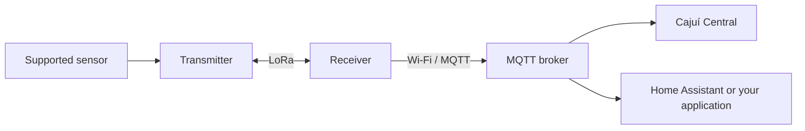

# Cajuí Firmware

English | [Português brasileiro](README.pt-BR.md)

**Firmware for Heltec ESP32/SX1262 boards: one code base turns a board into a
battery-powered sensor transmitter or into the receiver that delivers the
measurements over MQTT.**

The transmitter reads its sensor, sends the measurement over LoRa and sleeps until
the next cycle. The receiver accepts enrolled transmitters, acknowledges each frame,
keeps the samples in a persistent queue and publishes them over Wi-Fi to an MQTT
broker, where Cajuí Central, Home Assistant or your own application consume them.
Only the receiver needs Wi-Fi.

The link is Cajuí's own LoRa protocol, point to point with the receiver. One of the
same boards, running this firmware, does the receiving; there is no LoRaWAN gateway
or network server, and the system does not join LoRaWAN networks.

The reference builds read one climate sensor per transmitter, SHT4x or DHT22/AM2302,
on the boards in the [compatibility table](#compatible-boards-and-sensors). This
repository is the radio layer of [Cajuí](https://github.com/cajui/docs); the project
documentation explains the whole system and where it is heading.

[](https://github.com/cajui/cajui-firmware/actions/workflows/ci.yml)



**Experimental firmware.** Assembly, USB installation and network configuration
still require technical work. Range, network capacity, battery life and long-term
field reliability have not been established. Read the [status and limitations](docs/status.md)
before choosing it for an installation.

[Start here](#your-first-sensor-link) · [Compatible boards](#compatible-boards-and-sensors) ·
[Documentation](#documentation) · [Contribute](CONTRIBUTING.md)

## What it does

- Runs periodic measurement cycles with deep sleep between transmissions.
- Reads the supported sensor on each transmitter; current drivers measure
  temperature and humidity.
- Sends authenticated, encrypted radio frames and retries within a bounded delivery cycle.
- Stores accepted samples in the receiver before acknowledging them over LoRa.
- Keeps a persistent queue of up to 128 samples while MQTT is unavailable, then
  removes each sample after the broker acknowledges it. A full queue drops the oldest sample.
- Offers a receiver setup page for Wi-Fi, broker configuration, pairing and revocation.
- Reports battery voltage and radio signal alongside measurements, and publishes
  MQTT Discovery definitions for Home Assistant.

A radio acknowledgement confirms receiver acceptance. An MQTT acknowledgement
confirms broker acceptance. Neither proves that a monitoring application stored the
sample. [Delivery semantics](docs/radio-applications.md#forwarding-to-mqtt) explain
retries, queue limits and failures.

## Compatible boards and sensors

| Board | Role | Sensor | Build target |
| --- | --- | --- | --- |
| Heltec WiFi LoRa 32 V3 | Receiver | Receives enrolled transmitters | `runtime_rx` |
| Heltec WiFi LoRa 32 V3 | Transmitter | DHT22 / AM2302 | `runtime_tx` |
| Heltec Wireless Stick Lite V3 | Transmitter | SHT4x over I2C | `runtime_tx_stick_lite` |

Adding another sensor model requires driver and application support; plugging in
an arbitrary sensor does not identify or configure it automatically.

The Stick Lite image is installed over USB and is excluded from signed/web release
artifacts. Use its [wiring and installation guide](docs/stick-lite.md); a WiFi LoRa
32 image is not a substitute. See [reference applications](docs/radio-applications.md)
for DHT22 wiring. Qwiic/STEMMA QT adapters are optional when the same electrical
connections are made directly.

## Your first sensor link

You need two supported boards, a suitable LoRa antenna for **each** board, one
supported sensor, power, a USB data cable and a computer for installation. The
receiver also needs 2.4 GHz Wi-Fi and a reachable MQTT broker. Both boards transmit:
the receiver sends acknowledgements.

1. **Prepare the monitoring application.** Start
   [Cajuí Central and its included broker](https://github.com/cajui/cajui-central#try-it-without-hardware),
   or use an existing broker with [Home Assistant](docs/home-assistant.md).
2. **Build and install an image for each role.** This walkthrough describes `main`.
   Use the build command below and [USB installation](docs/provisioning.md#build-and-install),
   with the storage precautions in [installation and updates](docs/updates.md). Read the release notes when
   using a published image; it can be older than the development code described here.
   The Stick Lite target requires a source build and USB installation.
3. **Configure the receiver.** Hold PRG for three seconds, join its temporary Wi-Fi
   network, and open `http://192.168.4.1`. Save your Wi-Fi settings, then enter the
   broker address and dedicated producer credentials. Check both connection states.
4. **Pair the transmitter.** Open a pairing window on the receiver and hold PRG on
   the transmitter for three seconds to request joining. Approve the candidate as
   described in [radio pairing](docs/radio-pairing.md). [USB enrollment](docs/provisioning.md)
   is also available.
5. **Verify the first reading.** Check radio acceptance, then the measurement in
   your application. The normal transmitter cycle is five minutes; low-battery
   modes change this schedule. Name the device and sensor in the application.

To build the development images without accessing any device, install Git,
Python 3.10+ and [uv](https://docs.astral.sh/uv/), then run:

```sh
git clone https://github.com/cajui/cajui-firmware.git
cd cajui-firmware
uvx --from platformio==6.2.0 pio run -e runtime_rx -e runtime_tx_stick_lite
```

Use `-e runtime_tx` instead of `-e runtime_tx_stick_lite` for a WiFi LoRa 32 V3
transmitter with DHT22. Building does not install firmware. Initial installation
and updates have different storage requirements: preserve enrollment and counters
when updating an enrolled device. Do not erase its storage to troubleshoot it.

The default radio profile is 915.2 MHz and defaults to a bench transmit power of
−9 dBm. Frequency, power and antenna must suit your region; the firmware does not
select a regional configuration automatically. Minimum power does not make
transmitting without an antenna safe.

## Security and validation

Use the setup page and broker on a trusted network. The temporary setup access
point is open while enabled, MQTT transport is plaintext, and radio pairing does
not authenticate against an active nearby attacker. Frame encryption does not
remove these boundaries. See [security](SECURITY.md) and [implementation status](docs/status.md).

Host tests cover protocol, storage failure handling and sensor decoding. CI also
compiles the ESP32 targets. Those checks do not measure radio range, power use or
physical flash behavior. Home Assistant Discovery has automated checks; a complete
installation against Home Assistant still needs integration validation.

## Documentation

| Task | Guide |
| --- | --- |
| Understand the complete system | [Cajuí documentation](https://github.com/cajui/docs) |
| Wire sensors and understand board behavior | [Radio applications](docs/radio-applications.md) · [Stick Lite / SHT4x](docs/stick-lite.md) |
| Enroll, recover or revoke a transmitter | [USB administration](docs/provisioning.md) · [Radio pairing](docs/radio-pairing.md) |
| Install and update firmware | [Updates and storage precautions](docs/updates.md) |
| Use Home Assistant or MQTT management | [Home Assistant](docs/home-assistant.md) · [Management contract](docs/management-v1.md) |
| Understand the implementation | [Protocol](docs/protocol-v1.md) · [Runtime](docs/runtime.md) · [Persistence](docs/persistence.md) |
| Build, test or add support | [Development](docs/development.md) · [Testing](docs/testing.md) |
| Check what remains unvalidated | [Implementation status](docs/status.md) · [Roadmap](docs/roadmap.md) |

## Contributing

Report reproducible failures, improve setup instructions, or contribute sensor
support with tests and a documented board configuration. See
[CONTRIBUTING.md](CONTRIBUTING.md) before changing protocols or storage formats.
Keep credentials and identifying deployment data out of issues and logs.

## License

[Apache-2.0](LICENSE). Dependencies retain their own licenses. Test keys are public
fixtures and must never be used as device credentials.
