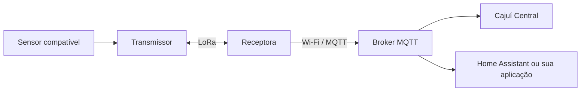

# Cajuí Firmware

[English](README.md) | Português brasileiro

**Firmware para placas Heltec ESP32/SX1262: a mesma base de código faz uma placa
funcionar como transmissor de sensor a bateria ou como a receptora que entrega as
medições por MQTT.**

O transmissor lê o sensor, envia a medição por LoRa e dorme até o próximo ciclo.
A receptora aceita os transmissores pareados, confirma cada quadro, guarda as
amostras em uma fila persistente e as publica por Wi-Fi em um broker MQTT, de onde
o Cajuí Central, o Home Assistant ou sua própria aplicação as consomem. Só a
receptora precisa de Wi-Fi.

O enlace é o protocolo LoRa próprio do Cajuí, ponto a ponto com a receptora. Uma
das mesmas placas, rodando este firmware, faz a recepção; não há gateway nem
servidor de rede LoRaWAN, e o sistema não entra em redes LoRaWAN.

As compilações de referência leem um sensor de clima por transmissor, SHT4x ou
DHT22/AM2302, nas placas da [tabela de compatibilidade](#placas-e-sensores-compatíveis).
Este repositório é a camada de rádio do
[Cajuí](https://github.com/cajui/docs/blob/main/README.pt-BR.md); a documentação
do projeto explica o conjunto e para onde ele vai.

[](https://github.com/cajui/cajui-firmware/actions/workflows/ci.yml)



**Firmware experimental.** Montagem, instalação por USB e configuração de rede
ainda exigem trabalho técnico. Alcance, capacidade da rede, autonomia e
confiabilidade de longo prazo em campo não foram estabelecidos. Consulte o
[estado e os limites](docs/status.md) antes de escolher o projeto para uma instalação.

[Comece aqui](#seu-primeiro-enlace-de-sensores) · [Placas compatíveis](#placas-e-sensores-compatíveis) ·
[Documentação](#documentação) · [Contribuir](CONTRIBUTING.md)

## O que ele faz

- Executa ciclos periódicos de medição com sono profundo entre transmissões.
- Lê o sensor compatível de cada transmissor; os drivers atuais medem
  temperatura e umidade.
- Envia quadros de rádio autenticados e criptografados, com tentativas limitadas por ciclo.
- Grava as amostras aceitas na receptora antes de confirmá-las pelo LoRa.
- Mantém uma fila persistente de até 128 amostras enquanto o MQTT está indisponível
  e remove cada amostra após a confirmação do broker. Uma fila cheia descarta a mais antiga.
- Oferece uma página na receptora para Wi-Fi, broker, pareamento e revogação.
- Informa tensão da bateria e sinal do rádio junto das medições e publica
  definições de MQTT Discovery para o Home Assistant.

Uma confirmação de rádio indica aceitação pela receptora. A confirmação MQTT
indica aceitação pelo broker. Nenhuma garante que uma aplicação de monitoramento
gravou a amostra. O guia de [entrega](docs/radio-applications.md#forwarding-to-mqtt)
explica tentativas, limites da fila e falhas.

## Placas e sensores compatíveis

| Placa | Papel | Sensor | Alvo de compilação |
| --- | --- | --- | --- |
| Heltec WiFi LoRa 32 V3 | Receptora | Recebe transmissores pareados | `runtime_rx` |
| Heltec WiFi LoRa 32 V3 | Transmissor | DHT22 / AM2302 | `runtime_tx` |
| Heltec Wireless Stick Lite V3 | Transmissor | SHT4x por I2C | `runtime_tx_stick_lite` |

Outro modelo de sensor exige suporte no driver e na aplicação; conectar um sensor
qualquer não faz sua identificação ou configuração automática.

A imagem da Stick Lite é instalada por USB e não faz parte dos artefatos de
release assinados ou do instalador web. Use o [guia de ligação e instalação](docs/stick-lite.md);
uma imagem da WiFi LoRa 32 não a substitui. Consulte as
[aplicações de referência](docs/radio-applications.md) para a ligação do DHT22.
Adaptadores Qwiic/STEMMA QT são opcionais quando as mesmas conexões elétricas
são feitas diretamente.

## Seu primeiro enlace de sensores

Você precisa de duas placas compatíveis, uma antena LoRa adequada para **cada**
placa, um sensor compatível, alimentação, um cabo USB de dados e um computador
para instalar o firmware. A receptora também precisa de Wi-Fi de 2,4 GHz e de
um broker MQTT acessível. As duas placas transmitem: a receptora envia confirmações.

1. **Prepare a aplicação de monitoramento.** Inicie o
   [Cajuí Central com seu broker incluído](https://github.com/cajui/cajui-central/blob/main/README.pt-BR.md#experimente-sem-hardware)
   ou use um broker existente com [Home Assistant](docs/home-assistant.md).
2. **Compile e instale a imagem de cada papel.** Este roteiro descreve a `main`.
   Use o comando de compilação abaixo e a [instalação USB](docs/provisioning.md#build-and-install),
   com os cuidados de armazenamento de [instalação e atualizações](docs/updates.md). Leia as notas da release ao usar
   uma imagem publicada; ela pode ser anterior ao código de desenvolvimento
   descrito aqui. A Stick Lite exige compilação do código e instalação por USB.
3. **Configure a receptora.** Segure PRG por três segundos, conecte à rede Wi-Fi
   temporária e abra `http://192.168.4.1`. Salve o Wi-Fi e depois informe o endereço
   do broker e as credenciais dedicadas de produtor. Confira as duas conexões.
4. **Pareie o transmissor.** Abra uma janela de pareamento na receptora e segure
   PRG no transmissor por três segundos para pedir entrada. Aprove o candidato
   conforme o guia de [pareamento por rádio](docs/radio-pairing.md). Também há
   [cadastro por USB](docs/provisioning.md).
5. **Confira a primeira leitura.** Verifique a aceitação pelo rádio e depois a
   medição na aplicação. O ciclo normal é de cinco minutos; os modos de bateria
   baixa mudam esse intervalo. Nomeie o dispositivo e o sensor na aplicação.

Para compilar as imagens de desenvolvimento sem acessar dispositivos, instale
Git, Python 3.10+ e [uv](https://docs.astral.sh/uv/) e execute:

```sh
git clone https://github.com/cajui/cajui-firmware.git
cd cajui-firmware
uvx --from platformio==6.2.0 pio run -e runtime_rx -e runtime_tx_stick_lite
```

Use `-e runtime_tx` no lugar de `-e runtime_tx_stick_lite` para um transmissor
WiFi LoRa 32 V3 com DHT22. Compilar não instala o firmware. Instalação inicial e
atualização têm requisitos diferentes de armazenamento: preserve o cadastro e
os contadores ao atualizar um dispositivo pareado. Não apague o armazenamento
para tentar resolver uma falha.

O perfil padrão usa 915,2 MHz e potência de bancada de −9 dBm. Frequência, potência
e antena precisam ser adequadas à sua região; o firmware não escolhe a configuração
regional automaticamente. Potência mínima não torna segura a transmissão sem antena.

## Segurança e validação

Use a página de configuração e o broker em uma rede confiável. O ponto de acesso
temporário fica aberto enquanto habilitado, o transporte MQTT não usa criptografia
e o pareamento por rádio não autentica contra um atacante ativo próximo.
A criptografia dos quadros não elimina esses limites. Consulte
[segurança](SECURITY.md) e [estado da implementação](docs/status.md).

Os testes no computador cobrem protocolo, falhas de armazenamento e decodificação
do sensor. O CI também compila os alvos ESP32. Esses testes não medem alcance,
consumo ou comportamento físico da memória flash. O MQTT Discovery tem testes
automatizados; a instalação completa com Home Assistant ainda precisa de validação
integrada.

## Documentação

Os guias técnicos deste repositório estão em inglês. A documentação do ecossistema
também está disponível em português.

| Tarefa | Guia |
| --- | --- |
| Entender o sistema completo | [Documentação Cajuí](https://github.com/cajui/docs/blob/main/README.pt-BR.md) |
| Ligar sensores e entender as placas | [Aplicações de rádio](docs/radio-applications.md) · [Stick Lite / SHT4x](docs/stick-lite.md) |
| Cadastrar, recuperar ou revogar um transmissor | [Administração USB](docs/provisioning.md) · [Pareamento por rádio](docs/radio-pairing.md) |
| Instalar e atualizar firmware | [Atualizações e cuidados com armazenamento](docs/updates.md) |
| Usar Home Assistant ou gestão MQTT | [Home Assistant](docs/home-assistant.md) · [Contrato de gestão](docs/management-v1.md) |
| Entender a implementação | [Protocolo](docs/protocol-v1.md) · [Runtime](docs/runtime.md) · [Persistência](docs/persistence.md) |
| Compilar, testar ou adicionar suporte | [Desenvolvimento](docs/development.md) · [Testes](docs/testing.md) |
| Conferir o que ainda não foi validado | [Estado da implementação](docs/status.md) · [Próximos marcos](docs/roadmap.md) |

## Contribuições

Relate falhas reproduzíveis, melhore instruções de montagem ou contribua com
suporte a sensores, acompanhado de testes e configuração de placa documentada.
Leia [CONTRIBUTING.md](CONTRIBUTING.md) antes de mudar protocolos ou formatos de
armazenamento. Não inclua credenciais ou dados que identifiquem instalações em
issues e logs.

## Licença

[Apache-2.0](LICENSE). As dependências mantêm suas próprias licenças. As chaves de
teste são públicas e nunca devem ser usadas como credenciais dos dispositivos.
